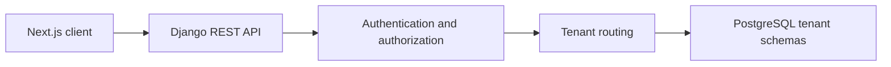

# Multi-Tenant File-Sharing SaaS

**Stack:** Django REST Framework, PostgreSQL, JWT, Next.js

## Problem
A client-facing file-sharing product needed tenant isolation, user onboarding, authentication, and reliable file-processing workflows.

## My contribution
- Designed a schema-per-tenant PostgreSQL approach to separate customer data while sharing common authentication and platform services.
- Developed Django REST APIs for onboarding, file workflows, and access-controlled operations.
- Implemented JWT authentication, permission checks, input validation, error handling, and unit tests for core backend paths.
- Integrated the API with a Next.js interface.

## Outcome
The platform provided a structured foundation for separate customer workspaces and secure application workflows. The case study describes implementation areas, not an audited security certification or public deployment claim.

## Architecture at a glance

The client repository and data remain private. This page is a high-level case study, not a reproduction of proprietary code.
